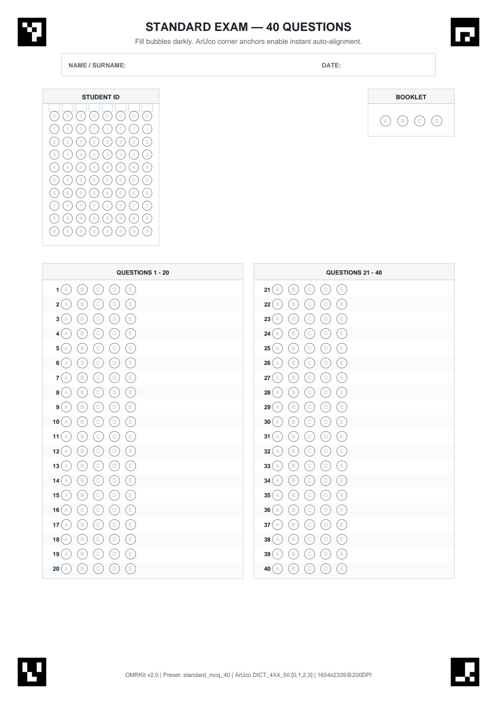

<div align="center">

# OMRKit v2.2

**Kalibrierungsfreie Optical-Mark-Recognition-Engine (OMR) mit 3-von-4-ArUco-Eckenwiederherstellung, Radiergummi-Schmierfilter, Kopierversatz-Mikroausrichtung, QR-Vorlagenerkennung, automatischer Rastererkennung mit Entzerrung, Browser-Live-Kamera, Unicode-Vektor-PDF-Generator, Klassischer Testtheorie (KTT), FastAPI-REST-API und 6-sprachigem Web Studio.**

[](https://github.com/duhanguler/omr/actions/workflows/ci.yml)
[](https://pypi.org/project/omrkit/)
[](https://omrkit-studio.onrender.com/)
[](https://github.com/duhanguler/omr/releases)
[](LICENSE)
[](pyproject.toml)
[](https://github.com/duhanguler/omr/pkgs/container/omr)

[**Live-Demo**](https://omrkit-studio.onrender.com/) · [**PyPI**](https://pypi.org/project/omrkit/) · [Deployment-Leitfaden](docs/DEPLOYMENT.md) · [Beispiele](examples/) · [Mitwirken](CONTRIBUTING.md)

[English](README.md) · [Türkçe](README.tr.md) · [简体中文](README.zh.md) · **Deutsch** · [Русский](README.ru.md) · [Español](README.es.md)

</div>

> **Öffentliche Web-Studio-Demo:** Direkt im Browser unter **[omrkit-studio.onrender.com](https://omrkit-studio.onrender.com/)** testen (verfügbar in **EN · TR · ZH · DE · RU · ES**). Klicken Sie oben auf **Beispieldaten**, um 5 Antwortbögen auszuwerten, markierte Felder per Tastatur (`A–E`, `Backspace`, `↑↓`) mit vergrößertem Ausschnitt zu prüfen oder eigene ArUco-PDFs zu erzeugen. *(Render Free Tier; Kaltstart ca. 20–30 s.)*

---

## Kernfunktionen (v2.2)

- **Praxistaugliche Computer-Vision-Pipeline:**
  - **Radiergummi-Schmierfilter (`erased_dominance_ratio`):** Unterscheidet zuverlässig zwischen verblassten Radierspuren und echten Mehrfachmarkierungen (`multi_marked`), während helle HB-Bleistiftmarkierungen sicher erkannt werden.
  - **3-von-4-ArUco-Wiederherstellung (`aruco_3pt`):** Ist eine Ecke durch Finger, Heftklammer oder Knick verdeckt, berechnet OMRKit eine exakte 12-Punkt-Homographie aus den 3 sichtbaren Markern.
  - **Block-Mikroausrichtung (`local_refinement`):** Korrigiert Druck- und Kopierversatz (`±6px`) pro Feldblock per Sobel-Kantenkorrelation auf die exakten Kreismittelpunkte.
  - **Auto-Deskew-Rastererkennung (`omrkit detect-layout`):** Richtet schief gescannte Leerformulare (`±12°`) automatisch gerade und erzeugt direkt eine `template.json`.
- **Druckfertige Unicode-PDFs & QR-Auto-Erkennung:** Erzeugt A4/Letter-Vektor-PDFs mit TrueType-Unicode-Typografie, ArUco-Markern `[0,1,2,3]` und QR-Vorlagencode; beim Scannen entfällt die manuelle Angabe von `-t template.json`.
- **Hybride Markierungserkennung & Prüfsummen:** Erkennt Vollmarkierungen ebenso wie **Häkchen (✓) und Kreuze (✗)** unter ungleichmäßigem Schatten; prüft Kennungen automatisch per **Luhn** oder **TC Kimlik No**.
- **Klassische Testtheorie (KTT) & Exporte:** Berechnet Mittelwert, Median, Standardabweichung, Schwierigkeitsindex ($p$), Trennschärfe ($D$, obere/untere 27 %), Antwortverteilung und **KR-20-Reliabilität**; Export als CSV, JSON, Excel (`.xlsx`) und individuelle **PDF-Ergebnisblätter**.
- **6-sprachiges Web Studio:**
  - **Scannen & Prüfen:** Vergrößerte Ausschnitte direkt in der Prüfwarteschlange, Live-Markierungsrahmen im Hauptbild und Tastatur-Triage (`A–E`, `Backspace`, `↑↓`).
  - **Vorlagen-Editor:** Direktes Verschieben von Blöcken auf dem Canvas, Pfeiltasten-Feinjustage (`1px` / `Shift 10px`), Rückgängig/Wiederholen (`Ctrl+Z` / `Ctrl+Shift+Z`), Live-Koordinatenanzeige und `OMRChecker`-v1-Migration.

---

## Echte Scans & Generierte Antwortbögen

<table>
  <tr>
    <td width="54%" align="center">
      
      <br />
      <sub><b>Smartphone-Aufnahme:</b> Grün = sicher erkannt (inkl. ✓ & ✗), Rot = Mehrfachmarkierung, Gelb = Prüfwarteschlange.</sub>
    </td>
    <td width="46%" align="center">
      
      <br />
      <sub><b>Kalibrierungsfreies Vektor-PDF:</b> A4/Letter mit ArUco [0,1,2,3], QR-Badge und exakt passender <code>template.json</code>.</sub>
    </td>
  </tr>
</table>

---

## Schnellstart (60 Sekunden)

```bash
# Installation über PyPI (empfohlen)
pip install omrkit              # CV-Kern + PDF + ArUco/QR + Generator + CLI
pip install "omrkit[all]"       # Komplettpaket inkl. Web Studio, FastAPI & Excel

# Oder direkt als offizielles Docker-Image starten
docker run -p 8000:8000 ghcr.io/duhanguler/omr:latest
```

### 1. Druckfertigen Antwortbogen erzeugen

```bash
omrkit generate --preset standard_mcq_40 -o pruefung
# Erzeugt: standard_mcq_40_sheet.pdf, template.json, answer_key.json
```

### 2. Bilder oder mehrseitige PDFs scannen & bewerten

```bash
# Automatische Vorlagenerkennung über QR-Code:
omrkit scan examples/standard_mcq_40q/scans -o outputs/auto_demo

# Mit expliziter Vorlage, Lösungsschlüssel, Excel-Report & PDF-Ergebnisblättern:
omrkit scan examples/standard_mcq_40q/scans \
  -t examples/standard_mcq_40q/template.json \
  -k examples/standard_mcq_40q/answer_key.json \
  --policy standard \
  --format csv,json,xlsx,scorecards \
  -o outputs/demo

# Vorlage automatisch aus beliebigem Leerformular erkennen (inkl. Entzerrung):
omrkit detect-layout examples/turkish_exam_50q/blank_form.jpg -o auto_template.json
```

### 3. Web Studio starten oder Python-SDK nutzen

```bash
omrkit studio
# Web Studio:   http://127.0.0.1:8000
# OpenAPI-Doku: http://127.0.0.1:8000/docs
```

```python
from omrkit import AnswerKey, ExamGrader, GradingPolicy, OMRScanner, Template

template = Template.from_file("examples/standard_mcq_40q/template.json")
batch = OMRScanner(template).scan_batch("examples/standard_mcq_40q/scans", workers=4)

key = AnswerKey.from_file("examples/standard_mcq_40q/answer_key.json")
report = ExamGrader(key, GradingPolicy.preset("standard")).grade_batch(batch.sheets)
print(f"Bewertet: {report.analytics.student_count} | Mittelwert: {report.analytics.mean_score} | KR-20: {report.analytics.kr20_reliability}")
```

---

## Lizenz

Veröffentlicht unter der [MIT-Lizenz](LICENSE). Copyright © 2026 Duhan Güler & Mitwirkende.
