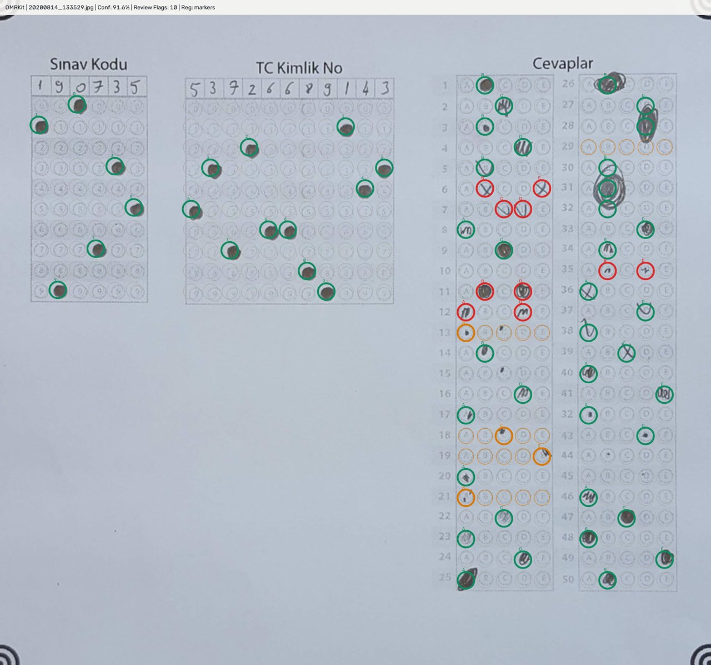

<div align="center">

# OMRKit v2.2

**Motor de Reconocimiento Óptico de Marcas (OMR) sin calibración manual: recuperación ArUco con 3 de 4 esquinas, tolerancia a manchas borradas de lápiz, microalineación de fotocopias, autodetección de plantilla por QR, detector de cuadrículas con autocorrección de inclinación, escáner por cámara web en vivo, generador PDF vectorial Unicode, psicometría (TCT), API REST FastAPI y Web Studio en 6 idiomas.**

[](https://github.com/duhanguler/omr/actions/workflows/ci.yml)
[](https://pypi.org/project/omrkit/)
[](https://omrkit-studio.onrender.com/)
[](https://github.com/duhanguler/omr/releases)
[](LICENSE)
[](pyproject.toml)
[](https://github.com/duhanguler/omr/pkgs/container/omr)

[**Demo en Vivo**](https://omrkit-studio.onrender.com/) · [**PyPI**](https://pypi.org/project/omrkit/) · [Guía de Despliegue](docs/DEPLOYMENT.md) · [Ejemplos](examples/) · [Contribuir](CONTRIBUTING.md)

[English](README.md) · [Türkçe](README.tr.md) · [简体中文](README.zh.md) · [Deutsch](README.de.md) · [Русский](README.ru.md) · **Español**

</div>

> **Demo en Vivo de Web Studio:** Pruébalo directamente en el navegador en **[omrkit-studio.onrender.com](https://omrkit-studio.onrender.com/)** (disponible en **EN · TR · ZH · DE · RU · ES**). Haz clic en **Lote de Muestra** para escanear y calificar 5 hojas ópticas, revisar incidencias con recortes ampliados y atajos de teclado (`A–E`, `Backspace`, `↑↓`), probar **Cámara en Vivo** o generar hojas ArUco + QR listas para imprimir. *(Alojado en el plan gratuito de Render; el primer arranque puede tardar ~20–30 s.)*

---

## Capacidades Clave (v2.2)

- **Visión por Computador Robusta para Papel Real:**
  - **Filtro de Borraduras (`erased_dominance_ratio`):** Distingue restos grises de borrador frente a dobles marcas reales (`multi_marked`), manteniendo 100% de precisión incluso con lápiz HB suave.
  - **Recuperación ArUco 3 de 4 (`aruco_3pt`):** Si un dedo, grapa o doblez cubre una esquina, reconstruye la homografía exacta con las 12 subesquinas de los 3 marcadores visibles.
  - **Microalineación por Bloque (`local_refinement`):** Correlación de bordes Sobel (`±6px`) para absorber desplazamientos de impresoras o fotocopias.
  - **Detector de Cuadrículas con Auto-Enderezado (`omrkit detect-layout`):** Corrige automáticamente inclinaciones de hasta `±12°` en formularios en blanco y genera `template.json`.
- **Generador PDF Vectorial Unicode + QR:** Produce hojas A4/Carta con tipografía TrueType Unicode, marcadores ArUco `[0,1,2,3]`, insignia QR de autodetección y archivo `template.json` exacto; permite escanear sin especificar `-t`.
- **Clasificador Híbrido y Validadores:** Lee relleno sólido, **marcas de verificación (✓) y cruces (✗)** bajo sombras irregulares; valida identificadores con **Luhn** y **TC Kimlik No**.
- **Psicometría de Teoría Clásica de los Tests (TCT):** Media, mediana, desviación estándar, dificultad ($p$), discriminación ($D$, 27% superior/inferior), distribución de distractores y fiabilidad **KR-20**; exportación en CSV, JSON, Excel (`.xlsx`) y **boletas PDF** individuales.
- **Web Studio en 6 Idiomas:**
  - **Escanear y Revisar:** Recortes ampliados de cada fila dudosa en la cola HITL, retícula SVG en vivo sobre la hoja y revisión por teclado (`A–E`, `Backspace`, `↑↓`).
  - **Diseñador de Plantillas:** Selección y arrastre directo de bloques en el lienzo, microajuste con flechas (`1px` / `Shift 10px`), Deshacer/Rehacer (`Ctrl+Z` / `Ctrl+Shift+Z`), coordenadas en vivo y migración desde `OMRChecker` v1.

---

## Detección Real y Hojas Generadas

<table>
  <tr>
    <td width="54%" align="center">
      
      <br />
      <sub><b>Foto móvil real:</b> Verde = lectura segura (incluye ✓ y ✗), Rojo = marca múltiple, Ámbar = cola de revisión ampliada.</sub>
    </td>
    <td width="46%" align="center">
      
      <br />
      <sub><b>PDF vectorial sin calibración:</b> A4/Carta con esquinas ArUco [0,1,2,3], código QR y <code>template.json</code> exacto.</sub>
    </td>
  </tr>
</table>

---

## Inicio Rápido (60 Segundos)

```bash
# Instalar desde PyPI (recomendado)
pip install omrkit              # Motor CV + PDF + ArUco/QR + Generador + CLI
pip install "omrkit[all]"       # Plataforma completa: Web Studio, FastAPI y Excel

# O ejecutar la imagen oficial de Docker sin compilar
docker run -p 8000:8000 ghcr.io/duhanguler/omr:latest
```

### 1. Generar una Hoja ArUco + QR Lista para Imprimir

```bash
omrkit generate --preset standard_mcq_40 -o mi_examen
# Genera: standard_mcq_40_sheet.pdf, template.json, answer_key.json
```

### 2. Escanear Imágenes o PDFs Multipágina

```bash
# Detección automática mediante QR (sin pasar plantilla):
omrkit scan examples/standard_mcq_40q/scans -o outputs/auto_demo

# Con plantilla explícita, clave de respuestas, Excel y boletas PDF:
omrkit scan examples/standard_mcq_40q/scans \
  -t examples/standard_mcq_40q/template.json \
  -k examples/standard_mcq_40q/answer_key.json \
  --policy standard \
  --format csv,json,xlsx,scorecards \
  -o outputs/demo

# Detectar cuadrículas automáticamente desde cualquier formulario en blanco:
omrkit detect-layout examples/turkish_exam_50q/blank_form.jpg -o auto_template.json
```

### 3. Iniciar Web Studio o Usar el SDK de Python

```bash
omrkit studio
# Web Studio:   http://127.0.0.1:8000
# OpenAPI Docs: http://127.0.0.1:8000/docs
```

```python
from omrkit import AnswerKey, ExamGrader, GradingPolicy, OMRScanner, Template

template = Template.from_file("examples/standard_mcq_40q/template.json")
batch = OMRScanner(template).scan_batch("examples/standard_mcq_40q/scans", workers=4)

key = AnswerKey.from_file("examples/standard_mcq_40q/answer_key.json")
report = ExamGrader(key, GradingPolicy.preset("standard")).grade_batch(batch.sheets)
print(f"Calificadas: {report.analytics.student_count} | Media: {report.analytics.mean_score} | KR-20: {report.analytics.kr20_reliability}")
```

---

## Licencia

Distribuido bajo la [Licencia MIT](LICENSE). Copyright © 2026 Duhan Güler & Colaboradores.
