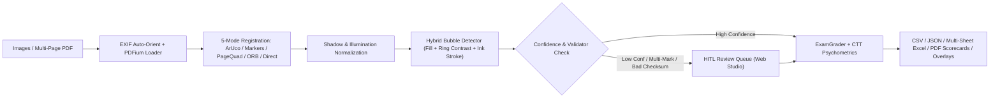

<div align="center">

# OMRKit v2.0

**Zero-calibration Optical Mark Recognition engine, printable ArUco sheet generator, Classical Test Theory exam psychometrics, FastAPI REST API, and Visual Web Studio.**

[](LICENSE)
[](pyproject.toml)
[](#web-studio--rest-api)
[](pyproject.toml)

[English](README.md) · [Türkçe](README.tr.md) · [Examples](examples/) · [Contributing](CONTRIBUTING.md)

</div>

---

## Why OMRKit?

Traditional open-source OMR scripts force you to hand-edit pixel coordinates in brittle JSON files, break on rotated mobile photos, fail on checkmarks/crosses, and dump raw CSVs without confidence scores or grading analytics. **OMRKit v2.0** solves the full lifecycle in one clean MIT-licensed toolkit:

| Capability | Legacy OMR Scripts | **OMRKit v2.0** |
| :--- | :---: | :---: |
| **Printable PDF Sheet Generator + Auto Template** | Manual JSON pixels | **1-click Vector PDF + Exact `template.json`** |
| **Multi-Page PDF & EXIF Auto-Orientation** | Single images only | **Native `pypdfium2` + EXIF auto-orient** |
| **0° / 90° / 180° / 270° Auto-Rotation** | Breaks when sideways | **ArUco IDs + Template-Structure Disambiguation** |
| **Checkmarks (✓), Crosses (✗) & Shadow Tolerance** | Global intensity only | **Illumination Normalization + Hybrid Ink Scorer** |
| **Confidence Scores & Human-in-the-Loop (HITL)** | Silent errors in CSV | **Calibrated `0–1` Confidence + 1-Click Review Queue** |
| **Exam Psychometrics & Scorecards** | Basic score sum | **CTT Difficulty ($p$), Discrimination ($D$), KR-20, Excel & PDF Cards** |
| **Visual Template Designer & REST API** | CLI only | **`omrkit studio` (React 19 Canvas + FastAPI OpenAPI)** |

---

## Real-World Detection & Generated Sheets

<table>
  <tr>
    <td width="54%" align="center">
      
      <br />
      <sub><b>Real mobile photo scan:</b> Emerald = confident (including ✓ & ✗ marks), Crimson = multi-marked, Amber = faint marks queued for 1-click HITL review.</sub>
    </td>
    <td width="46%" align="center">
      
      <br />
      <sub><b>Zero-calibration generated PDF:</b> Vector A4/Letter layout with ArUco corners [0,1,2,3] and exact companion <code>template.json</code>.</sub>
    </td>
  </tr>
</table>

---

## Quickstart (60 Seconds)

### 1. Install

```bash
git clone https://github.com/duhanguler/omr.git
cd omr
pip install -e ".[all]"
```

*(Or run via Docker with zero local setup: `docker compose up` → open `http://localhost:8000`)*

### 2. Generate a Print-Ready ArUco Sheet + Template

```bash
omrkit generate --preset standard_mcq_40 -o my_exam
# Writes: standard_mcq_40_sheet.pdf, template.json, answer_key.json
```

Built-in presets (`omrkit generate --list`):
- `quick_quiz_20` — 20 questions (A–D), 6-digit Student ID
- `standard_mcq_40` — 40 questions (A–E), 8-digit Student ID, Booklet (A–D)
- `turkish_exam_50` — 50 questions (A–E), 6-digit Sınav Kodu, 11-digit **TC Kimlik No** (with checksum validation), Booklet
- `turkish_yks_120` — 120-question YKS / TYT layout (4 columns × 30 rows)

### 3. Scan Images or Multi-Page PDFs & Grade

```bash
omrkit scan examples/standard_mcq_40q/scans \
  -t examples/standard_mcq_40q/template.json \
  -k examples/standard_mcq_40q/answer_key.json \
  --policy yks_tyt \
  --format csv,json,xlsx,scorecards \
  -o outputs/demo
```

Try the real-world hand-marked Turkish 50-question mobile scans too:

```bash
omrkit scan examples/turkish_exam_50q/scans \
  -t examples/turkish_exam_50q/template.json \
  -o outputs/turkish_demo
```

### 4. Launch Visual Web Studio & REST API

```bash
omrkit studio
# Web Studio:    http://127.0.0.1:8000
# OpenAPI Docs:  http://127.0.0.1:8000/docs
```

---

## Python SDK

Integrate optical scanning, grading, and psychometrics in 10 lines of typed Python:

```python
from omrkit import AnswerKey, ExamGrader, GradingPolicy, OMRScanner, Template

template = Template.from_file("examples/standard_mcq_40q/template.json")
scanner = OMRScanner(template)

batch = scanner.scan_batch("examples/standard_mcq_40q/scans", workers=4)

key = AnswerKey.from_file("examples/standard_mcq_40q/answer_key.json")
report = ExamGrader(key, GradingPolicy.preset("yks_tyt")).grade_batch(batch.sheets)

print(f"Graded {report.analytics.student_count} sheets | Mean: {report.analytics.mean_score}")
print(f"KR-20 Reliability: {report.analytics.kr20_reliability}")
```

---

## Architecture



### Key Technical Features
- **5 Registration Engines:** `aruco` (instant 0/90/180/270° recovery), `markers` (multi-scale concentric markers with template-structure orientation recovery), `page_quad` (borderless page contour), `homography` (ORB + RANSAC), and `none` (flatbed).
- **Shape-Aware Hybrid Bubble Classifier:** Evaluates inner circular fill ratio, 75th-percentile local ring contrast (immune to printed borders/numbers), and dark ink stroke density so pen checkmarks (`✓`) and crosses (`✗`) read accurately while smudges and multi-marks route to the HITL review queue.
- **Built-in Field Validators:** Algorithmic **Turkish TC Kimlik No** (11-digit mod-10/11), **Luhn**, `digits`, and `non_empty` validators flag misread IDs automatically.
- **Classical Test Theory (CTT) Psychometrics:** Mean, median, standard deviation, percentiles, per-item difficulty ($p$), upper/lower 27% discrimination index ($D$), option distractor distribution, and **KR-20** internal consistency reliability.
- **Grading Policies:** Standard, Turkish **YKS/TYT & KPSS** (4 wrong = -1 correct), **LGS** (3 wrong = -1 correct), multi-booklet (`A/B/C/D`), bonus/cancelled questions, and weighted sections.
- **Privacy Utility:** `omrkit strip-exif <dir> -o <clean_dir>` permanently bakes EXIF orientation into pixels and removes GPS/device metadata.

---

## Reproducible Benchmarks

Run `omrkit benchmark --samples 5` on your own machine to reproduce:

| Scenario (`standard_mcq_40`, 245 fields/scenario) | Accuracy | Avg Confidence | False HITL Flags | Single-Thread Throughput |
| :--- | :---: | :---: | :---: | :---: |
| Clean Flatbed Scan (Solid Fill) | **100.00%** | 99.2% | 0 | **~530 OMR/min** |
| Mobile Perspective + Uneven Shadow | **100.00%** | 99.2% | 0 | **~310 OMR/min** |
| Rotated 90° / 180° / 270° + Perspective | **100.00%** | 99.2% | 0 | **~415 OMR/min** |
| Pen Checkmarks (`✓`) + Shadow | **100.00%** | 99.1% | 0 | **~440 OMR/min** |

*(Multi-process batch mode via `--workers N` scales linearly across CPU cores.)*

---

## Web Studio & REST API

OMRKit Studio ships pre-bundled inside the Python package and launches via `omrkit studio` or `docker compose up`:

1. **Scan & Review (HITL):** Drag-and-drop JPG/PNG/PDF batches, inspect zoomable color-coded verification overlays, resolve flagged bubbles with 1-click overrides, and export CSV/Excel.
2. **Template Designer:** Upload any blank optical form image or PDF, draw bubble grid blocks directly on an interactive HTML5 canvas, tune spacing live, and export `template.json`.
3. **Sheet Generator:** Customize title, question count (5–120), option labels, booklet selector, and ID grids; preview live and download a ready-to-print ZIP bundle (`PDF + template.json + answer_key.json`).
4. **Grading & Analytics:** Inline answer-key editor, scoring policy selector, score histogram, student scoreboard with per-student **PDF Scorecards**, and full CTT item psychometrics.

### REST API Endpoints
- `GET /api/health` · `GET /api/presets`
- `POST /api/generate` · `POST /api/generate/bundle`
- `POST /api/templates/validate` · `POST /api/preview-image`
- `POST /api/scan` · `POST /api/grade`
- `POST /api/export/csv` · `POST /api/export/xlsx` · `POST /api/export/scorecard`

---

## Development

```bash
uv venv .venv
uv pip install --python .venv/bin/python -e ".[all,dev]"

# Python QA
.venv/bin/ruff check src tests
.venv/bin/mypy src/omrkit
.venv/bin/pytest -v --cov=omrkit

# Frontend Studio development
cd studio && npm ci && npm run dev
```

---

## License

Released under the [MIT License](LICENSE). Copyright © 2026 Duhan Güler & Contributors.
