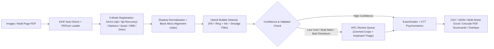

<div align="center">

# OMRKit v2.2

**Zero-calibration Optical Mark Recognition engine with 3-of-4 occluded ArUco recovery, erased-smudge resilience, photocopy drift micro-alignment, QR auto-template detection, blank-form auto-grid finder, live browser camera scanner, printable Unicode ArUco sheet generator, Classical Test Theory psychometrics, FastAPI REST API, and 6-language Web Studio.**

[](https://github.com/duhanguler/omr/actions/workflows/ci.yml)
[](https://pypi.org/project/omrkit/)
[](https://omrkit-studio.onrender.com/)
[](https://github.com/duhanguler/omr/releases)
[](LICENSE)
[](pyproject.toml)
[](https://github.com/duhanguler/omr/pkgs/container/omr)

[**Live Demo**](https://omrkit-studio.onrender.com/) · [**PyPI**](https://pypi.org/project/omrkit/) · [Deployment Guide](docs/DEPLOYMENT.md) · [Examples](examples/) · [Contributing](CONTRIBUTING.md)

**English** · [Türkçe](README.tr.md) · [简体中文](README.zh.md) · [Deutsch](README.de.md) · [Русский](README.ru.md) · [Español](README.es.md)

</div>

> **Live Web Studio:** Open **[omrkit-studio.onrender.com](https://omrkit-studio.onrender.com/)** directly in your browser (supports **EN · TR · ZH · DE · RU · ES**) — click **Sample Cohort** in the top bar to scan & grade 5 optical sheets, triage flagged bubbles with keyboard shortcuts (`A–E`, `Backspace`, `↑↓`), test **Live Camera**, or generate printable ArUco + QR sheets. *(Hosted on Render's free tier; cold start takes ~20–30s.)*

---

## Why OMRKit?

Traditional open-source OMR scripts require manual pixel-editing in brittle JSON files, break on rotated photos, fail when a thumb covers a corner fiducial or an eraser leaves a faint smudge, and output unverified CSV dumps. **OMRKit v2.2** handles the full optical grading pipeline in one MIT-licensed toolkit:

| Capability | Legacy OMR Scripts | **OMRKit v2.2** |
| :--- | :---: | :---: |
| **Printable PDF Generator + Exact Template** | Manual JSON pixels | **1-Click Unicode Vector PDF (ArUco + QR) + Exact `template.json`** |
| **Occluded Corner & Photocopy Drift** | Fails if 1 corner hidden or shifted | **3-of-4 ArUco 12-Point Recovery + ±6px Block Micro-Alignment** |
| **Erased Pencil Smudges vs. Double Marks** | False multi-mark flags | **Darkness-Dominance Filter (Rejects Smudges, Catches Double Marks)** |
| **Zero-Template QR Auto-Scanning** | Must pass template manually | **`omrkit scan sheet.jpg` auto-detects template from QR** |
| **Auto-Detect Grids on Blank Forms** | Measure pixels by hand | **Auto-Deskew (±12°) `omrkit detect-layout` + Interactive Canvas** |
| **Live Webcam / Mobile Browser Scanner** | Static files only | **Real-Time `getUserMedia` Viewfinder with Auto-Lock** |
| **Multi-Page PDF & EXIF Orientation** | Single images only | **Native `pypdfium2` + EXIF Auto-Orient** |
| **Checkmarks (✓), Crosses (✗) & Shadows** | Global intensity only | **Illumination Normalization + Hybrid Fill/Ring/Ink Classifier** |
| **Confidence & Keyboard HITL Review** | Silent errors in CSV | **Calibrated `0–1` Confidence + Zoomed Bubble Crops + `A–E` Triage** |
| **Exam Psychometrics & Scorecards** | Basic score sum | **CTT Difficulty ($p$), Discrimination ($D$), KR-20, Excel & Unicode PDF Cards** |
| **Legacy `OMRChecker` v1 Migration** | Manual rewrite | **`omrkit migrate-template old.json -o new.json`** |

---

## Real-World Detection & Generated Sheets

<table>
  <tr>
    <td width="54%" align="center">
      
      <br />
      <sub><b>Real mobile photo scan:</b> Emerald = confident (including ✓ & ✗ marks), Crimson = multi-marked, Amber = faint marks queued for zoomed HITL keyboard review.</sub>
    </td>
    <td width="46%" align="center">
      
      <br />
      <sub><b>Zero-calibration generated PDF:</b> Vector A4/Letter layout with native Unicode typography, ArUco corners [0,1,2,3], QR badge, and companion <code>template.json</code>.</sub>
    </td>
  </tr>
</table>

---

## Quickstart (60 Seconds)

### 1. Install from PyPI, Run via Docker, or Try Online

```bash
# Option A: Install from PyPI (recommended)
pip install omrkit              # Core CV engine + PDF + ArUco/QR + Sheet Generator + CLI
pip install "omrkit[all]"       # Full platform: adds 6-language Web Studio, FastAPI REST API & Excel

# Option B: Prebuilt official Docker image (zero build)
docker run -p 8000:8000 ghcr.io/duhanguler/omr:latest
```

- **Live Public Demo:** [https://omrkit-studio.onrender.com/](https://omrkit-studio.onrender.com/) (OpenAPI docs at [`/docs`](https://omrkit-studio.onrender.com/docs))
- **Self-Host (1-Click Render Blueprint):** [](https://dashboard.render.com/blueprint/new?repo=https://github.com/duhanguler/omr) · See [docs/DEPLOYMENT.md](docs/DEPLOYMENT.md) for GHCR & cloud deployment details.

### 2. Generate a Print-Ready ArUco + QR Sheet

```bash
omrkit generate --preset standard_mcq_40 -o my_exam
# Writes: standard_mcq_40_sheet.pdf, template.json, answer_key.json
```

Built-in presets (`omrkit generate --list`):
- `quick_quiz_20` — 20 questions (A–D), 6-digit Student ID
- `standard_mcq_40` — 40 questions (A–E), 8-digit Student ID, Booklet (A–D)
- `turkish_exam_50` — 50 questions (A–E), native Turkish Unicode headings, 6-digit Sınav Kodu, 11-digit **TC Kimlik No** (checksum validated), Booklet
- `turkish_yks_120` — 120-question YKS / TYT layout (4 columns × 30 rows)

### 3. Scan Images or Multi-Page PDFs (Explicit or Zero-Template QR Auto-Scan)

```bash
# Zero-template QR auto-detection on generated sheets:
omrkit scan examples/standard_mcq_40q/scans -o outputs/auto_demo

# Explicit template + YKS/TYT negative marking + Excel & PDF scorecards:
omrkit scan examples/standard_mcq_40q/scans \
  -t examples/standard_mcq_40q/template.json \
  -k examples/standard_mcq_40q/answer_key.json \
  --policy yks_tyt \
  --format csv,json,xlsx,scorecards \
  -o outputs/demo

# Auto-detect bubble grids from ANY blank form (with automatic ±12° deskew):
omrkit detect-layout examples/turkish_exam_50q/blank_form.jpg -o auto_template.json

# Migrate a legacy OMRChecker v1 template.json in one command:
omrkit migrate-template old_template.json -o template_v2.json
```

Try the real-world hand-marked Turkish 50-question mobile scans:

```bash
omrkit scan examples/turkish_exam_50q/scans \
  -t examples/turkish_exam_50q/template.json \
  -o outputs/turkish_demo
```

### 4. Launch Visual Web Studio & REST API

```bash
omrkit studio
# Web Studio:    http://127.0.0.1:8000
# OpenAPI Docs:  http://127.0.0.1:8000/docs
```

---

## Python SDK

Integrate optical scanning, grading, and psychometrics in 10 lines of typed Python:

```python
from omrkit import AnswerKey, ExamGrader, GradingPolicy, OMRScanner, Template

template = Template.from_file("examples/standard_mcq_40q/template.json")
scanner = OMRScanner(template)

batch = scanner.scan_batch("examples/standard_mcq_40q/scans", workers=4)

key = AnswerKey.from_file("examples/standard_mcq_40q/answer_key.json")
report = ExamGrader(key, GradingPolicy.preset("yks_tyt")).grade_batch(batch.sheets)

print(f"Graded {report.analytics.student_count} sheets | Mean: {report.analytics.mean_score}")
print(f"KR-20 Reliability: {report.analytics.kr20_reliability}")
```

---

## Architecture



### Key Technical Features
- **Resilient 5-Mode Registration:** `aruco` with 0°/90°/180°/270° recovery **plus 3-of-4 occluded corner 12-point homography (`aruco_3pt`)**, `markers` (multi-scale concentric markers), `page_quad` (borderless contour with polar corner ordering), `homography` (ORB + RANSAC), and `none` (flatbed).
- **Photocopy Micro-Alignment & Smudge-Safe Detector:** Per-block Sobel rim correlation snaps misaligned photocopies (`±6px`) back onto exact bubble centers. Hybrid inner fill + 75th-percentile ring contrast + ink stroke scoring + darkness-dominance smudge rejection reads checkmarks (`✓`), crosses (`✗`), and light pencil marks cleanly while flagging true double marks.
- **Built-in Field Validators:** Algorithmic **Turkish TC Kimlik No** (11-digit mod-10/11), **Luhn**, `digits`, and `non_empty` validators flag misread IDs automatically.
- **Classical Test Theory (CTT) Psychometrics:** Mean, median, standard deviation, percentiles, item difficulty ($p$), upper/lower 27% discrimination index ($D$), distractor distribution, and **KR-20** reliability.
- **Grading Policies & Native Unicode PDFs:** Standard, **YKS/TYT & KPSS** (4 wrong = -1 correct), **LGS** (3 wrong = -1 correct), multi-booklet (`A/B/C/D`), bonus/cancelled items, weighted sections, and automatic TrueType Unicode font discovery (`LiberationSans` / `DejaVuSans`) for generated sheets and student scorecards.
- **Privacy Utility:** `omrkit strip-exif <dir> -o <clean_dir>` bakes EXIF orientation into pixels and strips GPS/device metadata.

---

## Reproducible Benchmarks

Run `omrkit benchmark --samples 5` on your own machine to reproduce:

| Scenario (`standard_mcq_40`, 245 fields/scenario) | Accuracy | Avg Confidence | False HITL Flags | Single-Thread Throughput |
| :--- | :---: | :---: | :---: | :---: |
| Clean Flatbed Scan (Solid Fill) | **100.00%** | 99.2% | 0 | **~530 OMR/min** |
| Mobile Perspective + Uneven Shadow | **100.00%** | 99.2% | 0 | **~310 OMR/min** |
| Rotated 90° / 180° / 270° + Perspective | **100.00%** | 99.2% | 0 | **~415 OMR/min** |
| Pen Checkmarks (`✓`) + Shadow | **100.00%** | 99.1% | 0 | **~440 OMR/min** |
| **v2.2** Erased Smudge (`tone=170`) + Dark Fill (`tone=45`) | **100.00%** | 98.4% | 0 | **~490 OMR/min** |
| **v2.2** 1-of-4 Occluded ArUco + 90° Rotation + Skew | **100.00%** | 99.1% | 0 | **~360 OMR/min** |

*(Multi-process batch mode via `--workers N` scales linearly across CPU cores.)*

---

## Web Studio & REST API

OMRKit Studio ships pre-bundled inside the Python package in **6 languages (`EN · TR · ZH · DE · RU · ES`)** and launches via `omrkit studio` or `docker run`:

1. **Scan & Review (HITL):** Drop JPG/PNG/PDF batches with explicit template or **QR Auto-Detect**, inspect zoomed color-coded verification overlays with live bounding-box reticles, view magnified bubble-strip crops inside each flagged card, and resolve flags rapidly with keyboard shortcuts (`A–E`, `Backspace`, `↑↓`).
2. **Live Camera:** Browser webcam / smartphone viewfinder (`getUserMedia`) with **Auto-Lock** corner capture, live resolution readout, audio confirmation, and QR recognition.
3. **Template Designer:** Upload any blank optical form image or PDF, run **Auto-Detect Grids** (auto-deskewing up to ±12°), migrate legacy `OMRChecker` v1 JSONs, click-drag blocks directly on canvas, micro-nudge with arrow keys (`1px` / `Shift 10px`), and undo/redo cleanly (`Ctrl+Z` / `Ctrl+Shift+Z`).
4. **Sheet Generator:** Configure title, questions (5–120), option labels, booklet selector, and ID grids; inspect live print-spec telemetry, print directly (**Print PDF**), or download the ZIP bundle (`PDF + template.json + answer_key.json`).
5. **Grading & Analytics:** Multi-booklet inline answer-key editor, scoring policy selector, hover-interactive score histogram, sortable student scoreboard with Unicode **PDF Scorecards**, and filterable CTT psychometrics with inline option-distribution micro-bars.

### REST API Endpoints
- `GET /api/health` · `GET /api/presets`
- `POST /api/generate` · `POST /api/generate/bundle`
- `POST /api/templates/validate` · `POST /api/templates/auto-detect` · `POST /api/templates/migrate` · `POST /api/preview-image`
- `POST /api/scan` *(supports `template_json="auto"`, returns `overlays`, `review_crops`, `sheet_dimensions`)* · `POST /api/demo/cohort` · `POST /api/grade`
- `POST /api/export/csv` · `POST /api/export/xlsx` · `POST /api/export/scorecard`

---

## Development

```bash
uv venv .venv
uv pip install --python .venv/bin/python -e ".[all,dev]"

# Python QA
.venv/bin/ruff check src tests
.venv/bin/mypy src/omrkit
.venv/bin/pytest -v --cov=omrkit

# Frontend Studio development
cd studio && npm ci && npm run dev
```

---

## License

Released under the [MIT License](LICENSE). Copyright © 2026 Duhan Güler & Contributors.
